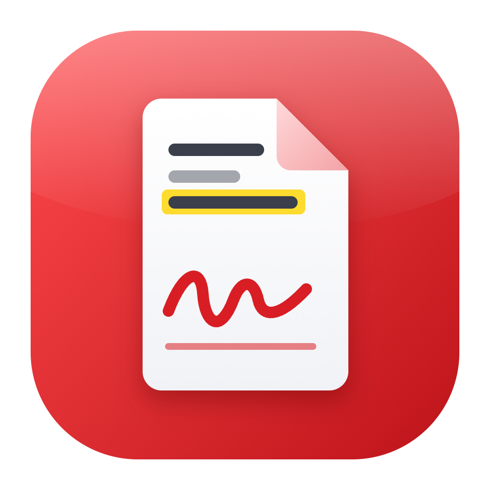
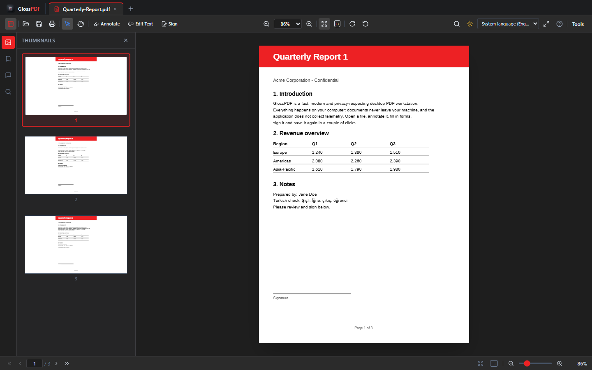
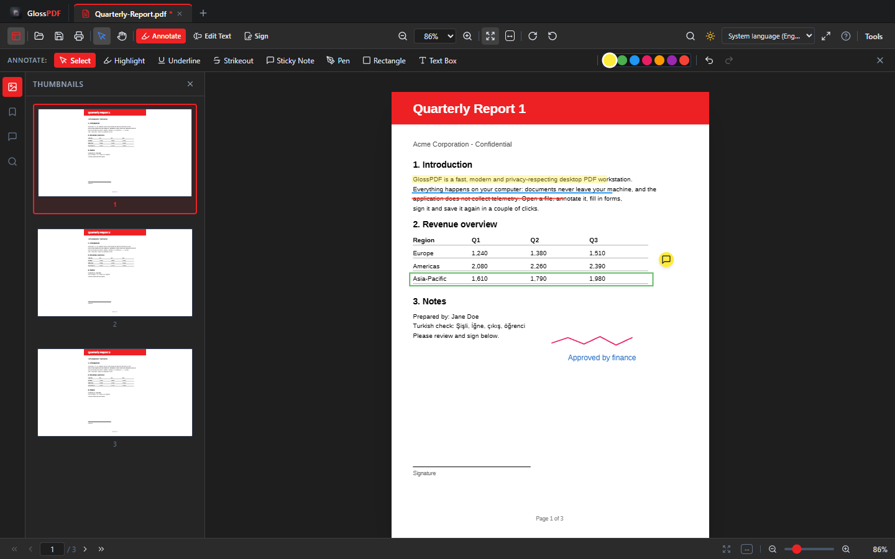
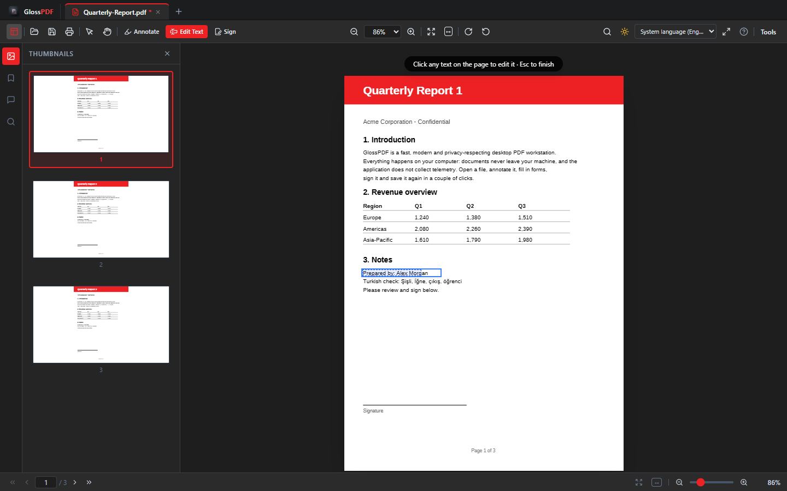
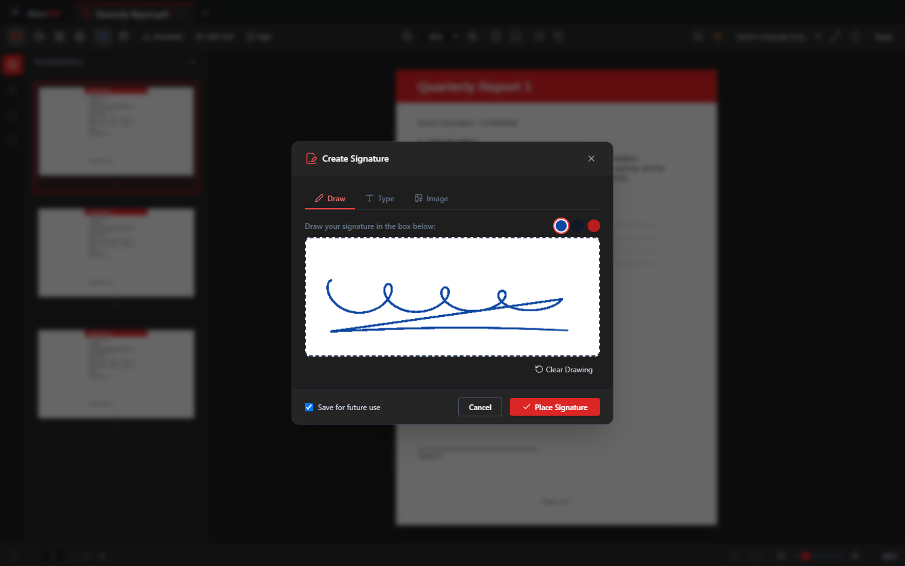
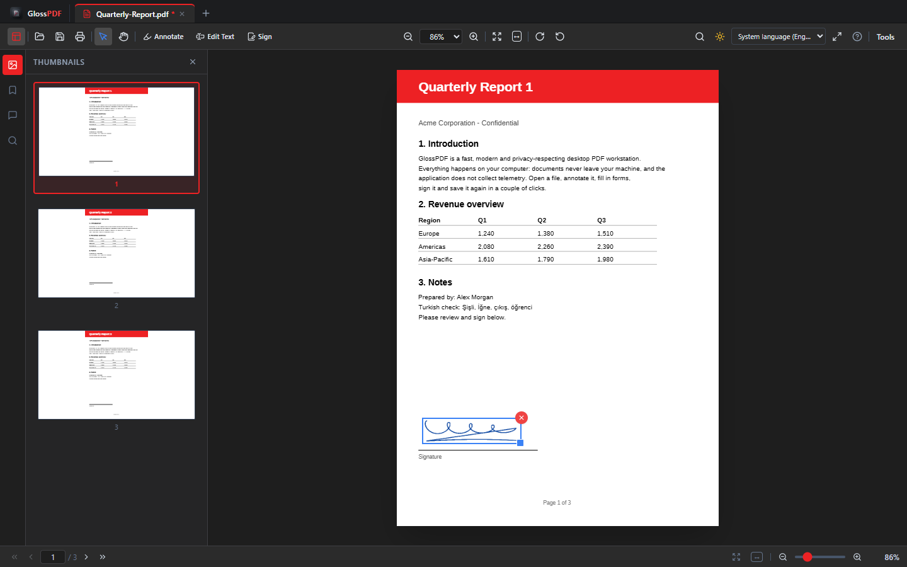
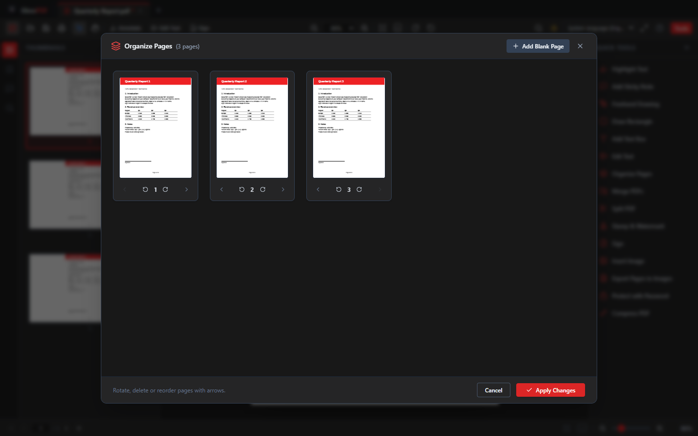
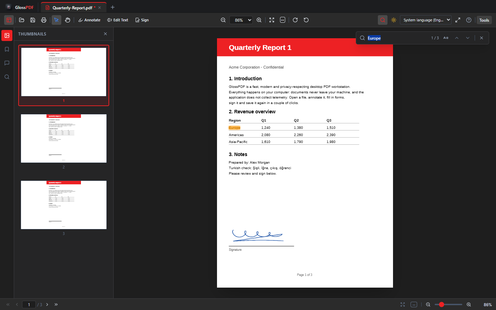
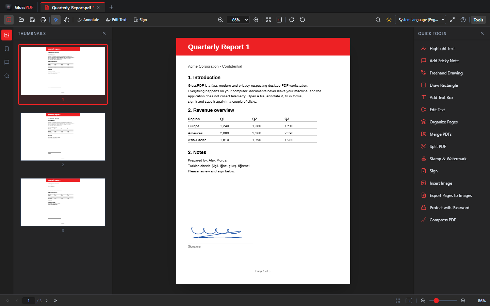
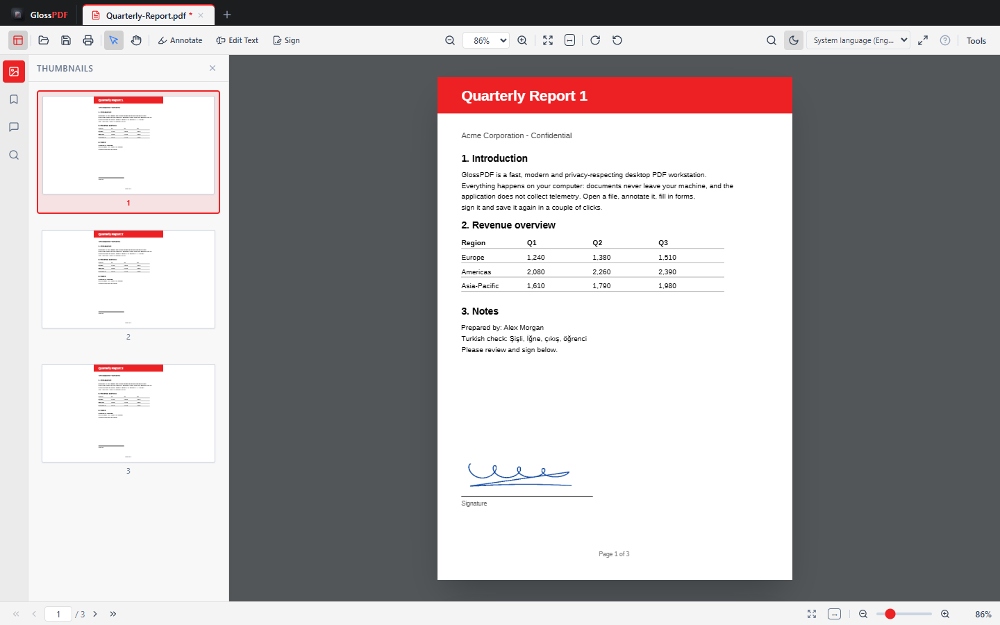

<div align="center">



# GlossPDF

**A fast, modern and privacy-respecting desktop PDF workstation.**
View, annotate, edit text, sign, organize and protect PDFs — entirely on your own computer.

[](LICENSE)
[](https://www.electronjs.org/)
[](https://react.dev/)
[](https://www.typescriptlang.org/)
[](#-installation)



</div>

---

## Table of contents

- [Why GlossPDF](#-why-glosspdf)
- [Screenshots](#-screenshots)
- [Features](#-features)
- [Keyboard shortcuts](#%EF%B8%8F-keyboard-shortcuts)
- [Installation](#-installation)
- [Development](#-development)
- [Project structure](#-project-structure)
- [How editing works](#-how-editing-works)
- [Known limitations](#-known-limitations)
- [Contributing](#-contributing)
- [License](#-license)

## ✨ Why GlossPDF

- **Local-first & private.** Documents are processed on your machine. No account, no cloud, no telemetry. (pdf.js downloads its CMap and standard-font data from the jsDelivr CDN on demand; this only matters for CJK and non-embedded-font PDFs.)
- **Familiar workflow.** Tab-based reader with thumbnails, bookmarks, search and a tool panel, in the spirit of the classic desktop readers.
- **Real editing, not just viewing.** Annotate, edit existing text, place signatures anywhere, reorganize pages, merge, split, watermark, compress and encrypt.
- **Multilingual.** Seven interface languages with automatic detection of the system language.

## 🖼️ Screenshots

| | |
|---|---|
| <br/>**Annotations** — highlight, underline, strikeout, sticky notes, pen, shapes and text boxes | <br/>**Edit Text** — click any text on the page and rewrite it in place |
| <br/>**Create a signature** — draw, type or import an image; keep it for next time | <br/>**Place it anywhere** — click to drop, drag to move, corner handle to resize |
| <br/>**Organize pages** — reorder, rotate, delete and insert pages | <br/>**Search** — matches are highlighted on the page, the active one in orange |
| <br/>**Quick tools panel** | <br/>**Light & dark themes** |

## 🚀 Features

### Reading & navigation
- Multi-tab interface, drag & drop to open, recent documents list
- Page thumbnails, bookmarks outline and full-text search with on-page match highlighting
- 15 zoom steps from **8.33 % to 800 %**, *Fit Page*, *Fit Width*, `Ctrl` + wheel zoom
- Password-protected PDFs, interactive form fields (text, checkbox, dropdown)
- Light / dark theme, full-screen mode

### Annotating
- **Text markup:** highlight, underline, strikeout (select text with the tool active)
- **Sticky notes**, **freehand pen**, **rectangles** and **text boxes**
- Annotations are written as standard `/Highlight`, `/Underline`, `/StrikeOut`, `/Text`, `/Ink` and `/Square` annotations **with appearance streams**, so they render the same in other PDF viewers
- Undo / redo, a comments sidebar, select / move / delete

### Edit text
- Choose **Edit Text**, click a line of text and type the replacement
- Background and text color are sampled from the page so the edit blends in
- Edits stay re-editable (double-click) until you save

### Sign
- **Create** a signature by drawing, typing (handwriting-style fonts) or importing an image (white background can be removed automatically)
- **Save signatures** for reuse (stored locally in the app)
- **Place anywhere:** click on any page to drop it, drag to move, use the corner handle to resize, `Delete` to remove

### Document tools
- **Organize pages:** reorder, rotate, delete, insert blank pages, extract
- **Merge** several PDFs, **split** by page ranges
- **Rotate** the whole document (saved into the file)
- **Watermark & stamps** (Unicode text supported)
- **Insert images**, **export pages as PNG / JPEG**
- **Compress / optimize** (object streams)
- **Password protection** with AES-256

### Internationalization
English, Türkçe, Deutsch, Français, Español, العربية (RTL) and 中文. The language follows your operating system by default and can be switched from the toolbar.

## ⌨️ Keyboard shortcuts

| Action | Shortcut |
|---|---|
| Open / Save / Save As | `Ctrl+O` / `Ctrl+S` / `Ctrl+Shift+S` |
| Print | `Ctrl+P` |
| Close tab | `Ctrl+W` |
| Find / next / previous | `Ctrl+F` / `F3` / `Shift+F3` |
| Zoom in / out | `Ctrl++` / `Ctrl+-` |
| Fit page / actual size / fit width | `Ctrl+0` / `Ctrl+1` / `Ctrl+2` |
| Rotate clockwise / counter-clockwise | `Ctrl+Shift+R` / `Ctrl+Shift+L` |
| Undo / redo | `Ctrl+Z` / `Ctrl+Y` |
| Delete selected annotation or signature | `Delete` |
| Leave Edit Text / signature placement | `Esc` |
| Full screen | `F11` |
| Shortcut cheat sheet | `F1` |

## 📥 Installation

Download the installer for your platform from the **[Releases](https://github.com/mesubasi/glosspdf/releases)** page:

| Platform | Package |
|---|---|
| Windows | `GlossPDF-Setup-x.y.z.exe` (NSIS installer) |
| macOS | `.dmg` / `.zip` (x64 and arm64) |
| Linux | `.AppImage` / `.deb` |

### First launch on an unsigned build

The installers are not code-signed yet, so Windows and macOS show a warning the first time you open GlossPDF. The app is open source and the releases are built by [GitHub Actions](.github/workflows/release.yml) from this repository.

- **Windows (SmartScreen):** click **More info → Run anyway**.
- **macOS (Gatekeeper):** right-click the app and choose **Open**, then confirm. If macOS says the app is damaged, run `xattr -cr /Applications/GlossPDF.app` and open it again.
- **Linux:** no warning. Make the AppImage executable first (`chmod +x GlossPDF-*.AppImage`) or install the `.deb` with `sudo apt install ./glosspdf_*_amd64.deb`.

## 🧑‍💻 Development

**Requirements:** [Node.js](https://nodejs.org/) 18+ and npm.

```bash
git clone https://github.com/mesubasi/glosspdf.git
cd glosspdf
npm install

# Start the desktop app with hot reload
npm run dev
```

```bash
# Type-check, bundle and build installers (output in ./release)
npm run build
```

```bash
# Publish a new version: bumps the patch version, commits, tags and pushes.
# The tag triggers the release workflow; installed apps pick up the update on next launch.
npm run release
```

> **Windows note:** if `vite build` fails with `remove ...\esbuild-... Access denied`, your antivirus is locking esbuild's temporary file for bundles larger than 1 MB. Add the project folder and your temp folder to the antivirus exclusions and rebuild.

## 🗂️ Project structure

```
electron/             Main process and preload bridge (open / save / print)
src/
  components/
    annotations/      Annotation layer, toolbar, sticky-note popover
    layout/           Header toolbar, sidebars, tab bar, status bar
    modals/           Signature, organize, merge, split, watermark, protect, ...
    pdf/              Document viewer, page renderer, search bar
  services/
    pdfRenderService  pdf.js rendering (canvas, text layer, form layer)
    pdfEditService    pdf-lib operations (save annotations, merge, split, encrypt, ...)
    textEditUtils     Color sampling for Edit Text
  store/              Zustand store (tabs, tools, undo/redo, modals)
  i18n/               7 locale dictionaries + system-language detection
public/               pdf.js worker, Liberation Sans
docs/screenshots/     Images used in this README
```

**Stack:** Electron 29 · React 18 · TypeScript · Vite 5 · Tailwind CSS · Zustand · [`pdfjs-dist`](https://github.com/mozilla/pdf.js) (rendering) · [`pdf-lib`](https://pdf-lib.js.org/) (editing) · `electron-builder` (packaging).

## 🔧 How editing works

Edits are kept as lightweight objects on top of the page and are written into the PDF only when you save:

- **Markup** (highlight, underline, strikeout, note, pen, rectangle) becomes a standard PDF annotation with an appearance stream.
- **Text boxes, signatures and text edits** are drawn into the page content with an embedded Unicode font (Liberation Sans), so characters such as `ş ğ İ ı ö ü ç` are preserved.
- **Edit Text** covers the original text run with a background-colored rectangle and draws the new text on top (see limitations).
- Page rotation, reordering and similar structural changes first flush any pending edits into the file, so nothing is left attached to the wrong page.

## ⚠️ Known limitations

- **Edit Text replaces, it does not reflow.** The original glyphs are covered, not removed from the file, so the old text can still be found by text extraction or copied from other tools. Do **not** use it to redact sensitive information. The replacement uses Liberation Sans rather than the document's original font, and edits apply to one text run (usually a line) at a time.
- Signatures are **visual** signatures (an image on the page), not cryptographic digital signatures.
- Password protection is applied when you export / apply it; an encrypted document can't be edited further in the same session.
- Text typed into text boxes and edits supports Latin, Cyrillic and Greek scripts; Arabic, Chinese and other scripts need a different embedded font.

## 🤝 Contributing

Issues and pull requests are welcome.

1. Fork the repository and create a feature branch.
2. Run `npx tsc --noEmit` before committing — the project must type-check.
3. When you add a UI string, add the same key to **every** file in `src/i18n/locales/`.
4. Open a pull request describing the change and how you tested it.

## 📄 License

Released under the [MIT License](LICENSE). Bundled third-party assets: pdf.js (Apache-2.0), pdf-lib (MIT), Liberation Sans fonts (SIL OFL 1.1, see `public/fonts/LICENSE_LIBERATION`).
