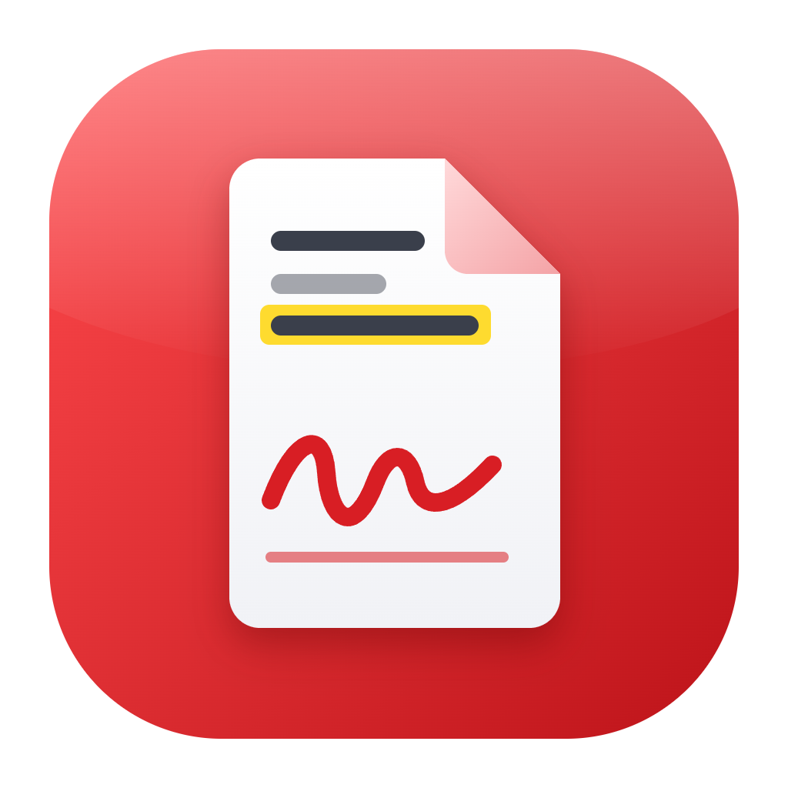
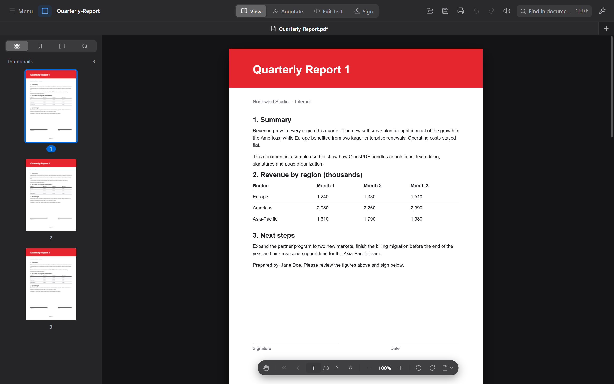
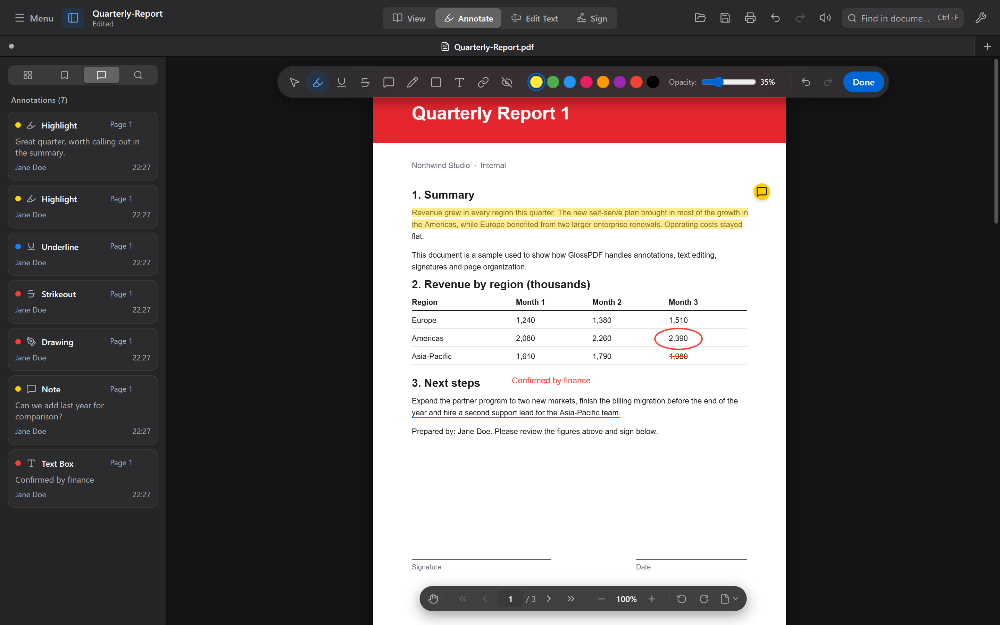
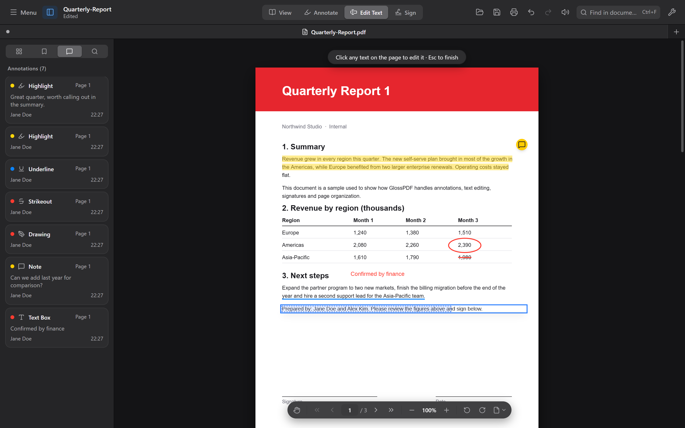
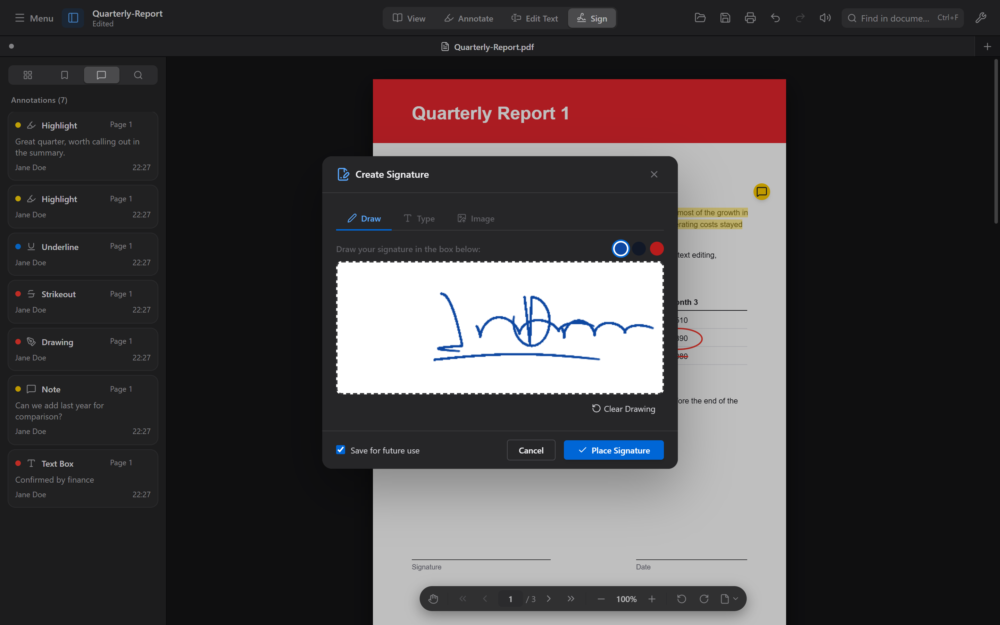
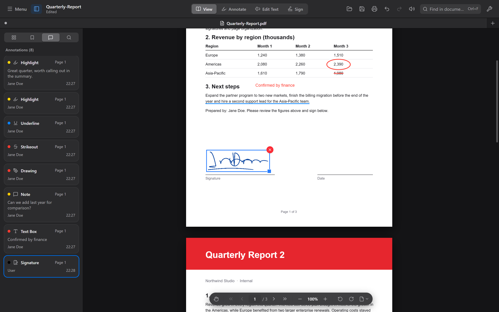
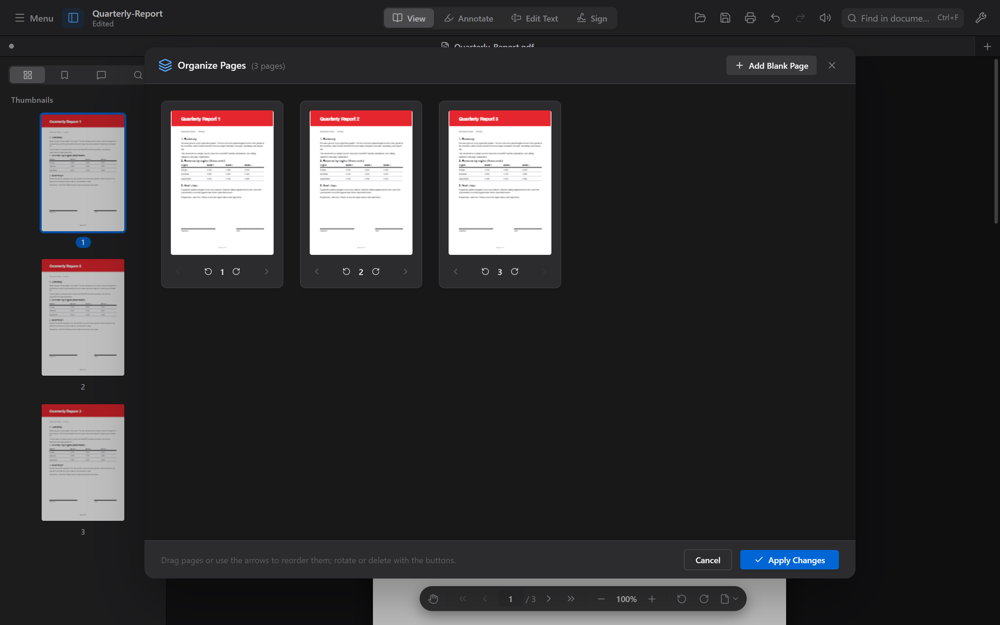
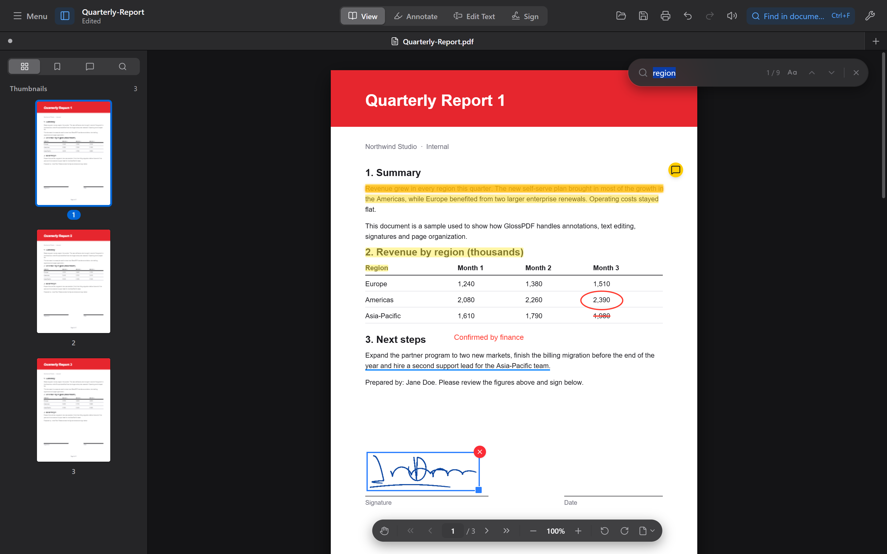
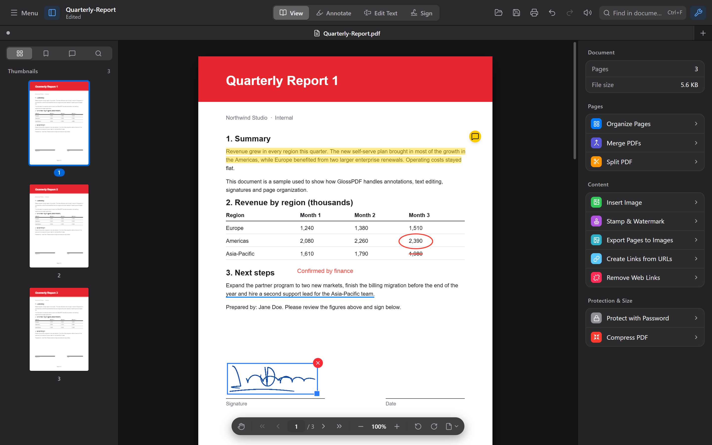
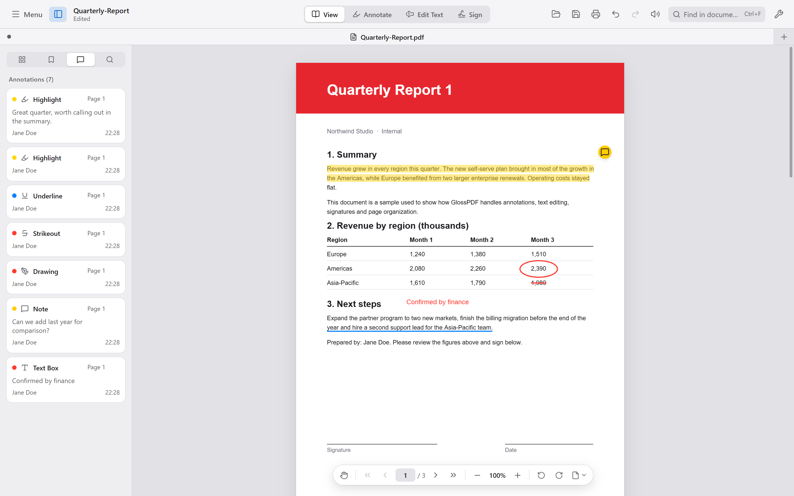

<div align="center">



# GlossPDF

**A fast, modern and privacy-respecting desktop PDF workstation.**

View, annotate, edit, sign, convert, organize and protect PDFs — entirely on your own computer.

[](https://github.com/mesubasi/glosspdf/releases/latest)
[](LICENSE)
[](#installation)
[](https://www.electronjs.org/)
[](https://react.dev/)
[](https://www.typescriptlang.org/)

[Download](https://github.com/mesubasi/glosspdf/releases/latest) · [Features](#features) · [Development](#development) · [Report an issue](https://github.com/mesubasi/glosspdf/issues)



</div>

---

## Table of contents

- [Highlights](#highlights)
- [Screenshots](#screenshots)
- [Features](#features)
- [Keyboard shortcuts](#keyboard-shortcuts)
- [Installation](#installation)
- [Updates](#updates)
- [Privacy](#privacy)
- [Development](#development)
- [Project structure](#project-structure)
- [How editing works](#how-editing-works)
- [Known limitations](#known-limitations)
- [Contributing](#contributing)
- [License](#license)

## Highlights

- **Local-first and private.** Every document is processed on your machine. No account, no cloud, no telemetry, and it works fully offline.
- **Real editing, not just viewing.** Annotate, edit existing text, sign, redact, reorganize pages, merge, split, watermark, compress, encrypt and convert to Office formats.
- **Interoperable output.** Annotations are saved as standard PDF annotations, so they look the same in Acrobat, Preview and other viewers.
- **Native desktop experience.** Tabs, drag and drop, file associations, printing and a clean interface designed around Apple's Human Interface Guidelines, with light and dark themes.
- **Multilingual.** Seven interface languages, following your system language by default.

## Screenshots

| | |
|---|---|
| <br/>**Annotations** — highlight, underline, strikeout, sticky notes, pen, shapes and text boxes | <br/>**Edit Text** — click any text on the page and rewrite it in place |
| <br/>**Create a signature** — draw, type or import an image, and keep it for next time | <br/>**Place it anywhere** — click to drop, drag to move, corner handle to resize |
| <br/>**Organize pages** — reorder, rotate, delete and insert pages | <br/>**Search** — matches are highlighted on the page, the active one in orange |
| <br/>**Quick tools panel** | <br/>**Light and dark themes** |

## Features

### Reading and navigation

- Multi-tab interface, drag and drop to open, recent documents list
- Open PDFs from your file manager (double-click or *Open with*); GlossPDF can be set as the default PDF app
- Page thumbnails, bookmarks outline and full-text search with on-page match highlighting
- Single-page and two-page views, with an optional cover page
- 15 zoom steps from **8.33 % to 800 %**, *Fit Page*, *Fit Width* and `Ctrl` + mouse wheel zoom
- Clickable links: web addresses open in your browser, in-document links jump to the target page
- **Read Aloud** with your system's text-to-speech voices (pause, resume, stop)
- Password-protected PDFs and interactive form fields (text, checkbox, dropdown)
- Printing with annotations included, full-screen mode, light and dark themes
- **Document Properties:** title, author, subject, keywords, dates, producer, PDF version, page size and file size

### Annotating

- **Text markup:** highlight (with adjustable opacity), underline and strikeout — select text with the tool active
- **Sticky notes**, **freehand pen**, **rectangles** and **text boxes**
- Select, move and delete annotations; full undo and redo; a comments sidebar
- Annotations are written as standard `/Highlight`, `/Underline`, `/StrikeOut`, `/Text`, `/Ink` and `/Square` annotations **with appearance streams**
- Comments already in the file — including ones added in Acrobat, Preview or other apps — appear in the sidebar and can be edited or deleted; untouched comments are preserved exactly as they were
- **Redact:** draw boxes over sensitive content; on save, the content underneath is permanently removed from the file (see [Known limitations](#known-limitations))

### Editing text

- Choose **Edit Text**, click a line of text and type the replacement
- Background and text colors are sampled from the page so the edit blends in
- Edits stay re-editable (double-click) until you save

### Signing

- **Create** a signature by drawing, typing (handwriting-style fonts) or importing an image; a white background can be removed automatically
- **Save signatures** for reuse (stored locally in the app)
- **Place anywhere:** click on any page to drop it, drag to move, use the corner handle to resize and `Delete` to remove

### Document tools

- **Organize pages:** reorder by drag and drop, rotate, delete, insert blank pages and extract
- **Merge** several PDFs and **split** by page ranges
- **Rotate** the whole document (saved into the file)
- **Watermarks and stamps** with position, angle, opacity and live preview (Unicode text supported)
- **Insert images** with click-to-place, and **export pages** as PNG or JPEG
- **Convert to Word, Excel or PowerPoint** on your device:
  - *Word* — editable text with paragraphs and headings
  - *Excel* — one worksheet per page, text placed into rows and columns
  - *PowerPoint* — one slide per page, visually identical to the PDF
- **Compress** with three presets (light, balanced, strong) or custom image resolution and JPEG quality; optionally convert images to grayscale and remove metadata, embedded thumbnails, attachments and JavaScript. Text and vector graphics are left untouched
- **Password protection** with AES-256 encryption
- Tool outputs are saved through the native save dialog, and you are asked before unsaved changes are discarded when closing a tab or quitting

### Languages

English, Türkçe, Deutsch, Français, Español, العربية (right-to-left) and 中文. The interface follows your operating system language by default; you can change it from the main menu.

## Keyboard shortcuts

On macOS, use `Cmd` in place of `Ctrl`. Press `F1` in the app for the full cheat sheet.

| Action | Shortcut |
|---|---|
| Open / Save / Save As | `Ctrl+O` / `Ctrl+S` / `Ctrl+Shift+S` |
| Print | `Ctrl+P` |
| Document properties | `Ctrl+D` |
| Close tab / Quit | `Ctrl+W` / `Ctrl+Q` |
| Find / next / previous match | `Ctrl+F` / `F3` / `Shift+F3` |
| Zoom in / out | `Ctrl++` / `Ctrl+-` |
| Fit page / actual size / fit width | `Ctrl+0` / `Ctrl+1` / `Ctrl+2` |
| Rotate clockwise / counter-clockwise | `Ctrl+Shift+R` / `Ctrl+Shift+L` |
| Undo / redo | `Ctrl+Z` / `Ctrl+Y` (or `Ctrl+Shift+Z`) |
| Delete selected annotation or signature | `Delete` |
| Leave Edit Text or signature placement | `Esc` |
| Full screen | `F11` or `Ctrl+L` |
| Keyboard shortcut cheat sheet | `F1` |

## Installation

Download the package for your platform from the **[latest release](https://github.com/mesubasi/glosspdf/releases/latest)**:

| Platform | Package |
|---|---|
| Windows | `GlossPDF-Setup-x.y.z.exe` (installer) or `GlossPDF-x.y.z-portable.exe` (no installation required) |
| macOS | `.dmg` or `.zip`, for Apple silicon (arm64) and Intel (x64) |
| Linux | `.AppImage` or `.deb` |

### First launch

GlossPDF installers are not code-signed, so Windows and macOS show a security prompt the first time you open the app. All releases are built from this repository by the [release workflow](.github/workflows/release.yml) on GitHub Actions.

- **Windows (SmartScreen):** click **More info → Run anyway**.
- **macOS (Gatekeeper):** right-click the app, choose **Open**, then confirm. If macOS reports that the app is damaged, run `xattr -cr /Applications/GlossPDF.app` and open it again.
- **Linux:** make the AppImage executable (`chmod +x GlossPDF-*.AppImage`), or install the Debian package with `sudo apt install ./glosspdf_*_amd64.deb`.

## Updates

Installed builds check [GitHub Releases](https://github.com/mesubasi/glosspdf/releases) for new versions on launch, and whenever you choose **Check for updates** in the main menu. You can either download updates automatically and install them when you quit, or be asked before each download.

The Windows portable build does not update itself; download new versions from the releases page.

## Privacy

GlossPDF does not collect, store or transmit your documents or personal data. All processing — including Office conversion and text-to-speech — happens on your device.

The only network connection the app makes on its own is the update check described in [Updates](#updates), which reads release information from GitHub and, if allowed, downloads the update from there. See [GitHub's privacy statement](https://docs.github.com/en/site-policy/privacy-policies/github-general-privacy-statement). Links inside a document open in your browser only when you click them.

## Development

**Requirements:** [Node.js](https://nodejs.org/) 22 or newer and npm.

```bash
git clone https://github.com/mesubasi/glosspdf.git
cd glosspdf
npm install
```

| Command | Description |
|---|---|
| `npm run dev` | Start the desktop app with hot reload |
| `npm run build` | Type-check, bundle and build installers for the current platform (output in `./release`) |
| `npx tsc --noEmit` | Type-check only |
| `npm run release` | Bump the patch version, commit, tag and push; the tag triggers the release workflow |

> **Windows note:** if `vite build` fails with `remove ...\esbuild-... Access denied`, your antivirus is locking esbuild's temporary file for bundles larger than 1 MB. Add the project folder and your temp folder to the antivirus exclusions and rebuild.

## Project structure

```
electron/             Main process (windows, file I/O, printing, updates) and preload bridge
src/
  components/
    annotations/      Annotation layer, annotation toolbar, sticky-note popover
    common/           Shared UI pieces
    layout/           Main menu, header toolbar, sidebars, tab bar, status bar
    modals/           Signature, organize, merge, split, watermark, compress,
                      protect, convert, document properties, updates, ...
    pdf/              Document viewer, page renderer, search bar
  hooks/              Keyboard shortcuts, Read Aloud
  services/
    pdfRenderService  pdf.js rendering (canvas, text layer, form layer)
    pdfEditService    pdf-lib operations (annotations, merge, split, compress, encrypt, ...)
    officeExportService  PDF to Word, Excel and PowerPoint conversion
    fileSaveService   Native open and save dialogs
    searchService     Full-text search
    textEditUtils     Color sampling for Edit Text
    watermarkLayout   Watermark positioning
  store/              Zustand store (tabs, tools, undo/redo, modals)
  i18n/               Locale dictionaries and system language detection
  types/              Shared TypeScript types
public/               pdf.js worker and assets, Liberation Sans fonts
docs/screenshots/     Images used in this README
```

**Stack:** Electron · React · TypeScript · Vite · Tailwind CSS · Zustand · [`pdfjs-dist`](https://github.com/mozilla/pdf.js) (rendering) · [`pdf-lib`](https://pdf-lib.js.org/) (editing) · `docx`, `write-excel-file` and `pptxgenjs` (Office export) · `electron-updater` (updates) · `electron-builder` (packaging)

## How editing works

Edits are kept as lightweight objects on top of the page and are written into the PDF only when you save:

- **Markup** (highlight, underline, strikeout, note, pen, rectangle) becomes a standard PDF annotation with an appearance stream.
- **Text boxes, signatures and text edits** are drawn into the page content with an embedded Unicode font (Liberation Sans), so characters such as `ş ğ İ ı ö ü ç` are preserved.
- **Edit Text** covers the original text run with a background-colored rectangle and draws the new text on top (see [Known limitations](#known-limitations)).
- Structural changes such as rotating or reordering pages first flush pending edits into the file, so nothing is left attached to the wrong page.

## Known limitations

- **Edit Text replaces, it does not reflow.** The original glyphs are covered, not removed, so the old text can still be found by text extraction or copied with other tools. Do **not** use it to hide sensitive information — use **Redact** instead. The replacement uses Liberation Sans rather than the document's original font, and each edit applies to one text run (usually a line).
- **Redact** converts every page that contains a redaction into an image; the rest of the document is untouched. Text on those pages can no longer be selected or searched, their form fields are removed, and the document's accessibility tags are dropped because they can hold a copy of the hidden text.
- **Existing comments:** free text boxes, circles, lines, stamps and other comment types from other apps are displayed but cannot be edited yet. Replies are not listed, and deleting a comment also deletes its replies. An edited comment is rewritten as a GlossPDF annotation, which replaces its original custom appearance.
- **Office conversion:** images and complex layouts are not carried over to Word and Excel. Scanned documents without selectable text can only be converted to PowerPoint, and PDFs whose owner has restricted content copying cannot be converted.
- **Signatures** are visual signatures (an image on the page), not cryptographic digital signatures.
- **Password protection** is applied when you save a protected copy; an encrypted document cannot be edited further in the same session.
- **Scripts:** text typed into text boxes and text edits supports Latin, Cyrillic and Greek. Arabic, Chinese and other scripts require a different embedded font.

## Contributing

Bug reports, feature requests and pull requests are welcome.

1. Fork the repository and create a feature branch.
2. Make sure the project type-checks with `npx tsc --noEmit`.
3. When you add a UI string, add the same key to **every** file in `src/i18n/locales/`.
4. Open a pull request that describes the change and how you tested it.

## License

Copyright (C) 2026 GlossPDF Contributors

GlossPDF is free software: you can redistribute it and/or modify it under the terms of the [GNU General Public License](LICENSE) as published by the Free Software Foundation, either version 3 of the License, or (at your option) any later version. It is distributed WITHOUT ANY WARRANTY; see the license for details.

Releases up to and including v1.0.8 were published under the MIT License, and that grant still applies to those versions.

**Third-party components:** pdf.js (Apache-2.0), pdf-lib (MIT), Liberation Sans fonts (SIL OFL 1.1, see `public/fonts/LICENSE_LIBERATION`), Geist and Caveat fonts (SIL OFL 1.1).

### Name and logo

The GlossPDF name and logo are not covered by the GPL or any other license in this repository. Forks and modified builds must be published under a different name and with a different logo. You may still state that your project is based on GlossPDF.
